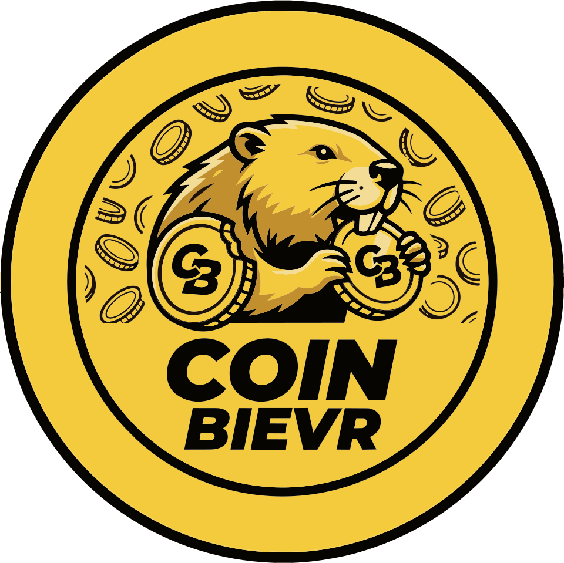
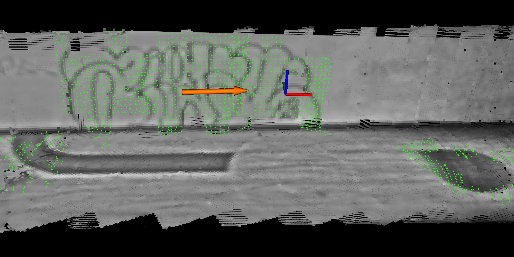

<p align="center">
  
</p>

# COIN-BIEVR: 3D Intensity Mapping for Robust LiDAR-Inertial Odometry

<p align="center">
<a href="https://icra2026-rigorous-perception.github.io/pdf/pfreundschuh2026.pdf"></a>
<a href="LICENSE"></a>
</p>

<p align="center">
<a href="https://github.com/ethz-asl/COIN-BIEVR/actions/workflows/build_20_04.yaml"></a>
<a href="https://github.com/ethz-asl/COIN-BIEVR/actions/workflows/build_22_04.yaml"></a>
<a href="https://github.com/ethz-asl/COIN-BIEVR/actions/workflows/build_24_04.yaml"></a>
</p>

<p align="center">
  
</p>

COIN-BIEVR is a LiDAR-Inertial Odometry framework that integrates intensity
directly into a high-resolution 3D map, adding photometric constraints in
geometrically degenerate environments such as tunnels or flat fields. It works with
both dense and irregular scan patterns.

COIN-BIEVR is the intensity-augmented follow-up of
[BIEVR-LIO](https://github.com/ethz-asl/BIEVR-LIO) and extends its voxel-wise oriented
height image map with an additional intensity layer.

<details>
<summary><b>Abstract</b></summary>
<br>
Purely geometry-based LiDAR-Inertial Odometry (LIO) often fails in geometrically degenerate environments, like tunnels or flat fields. While current intensity-augmented methods mitigate this, they rely on dense intensity images for feature detection and gradient calculation. This introduces errors from approximated projection models and is incompatible with the irregular scan patterns of many modern sensors. To address this, we propose COIN-BIEVR, which integrates intensity directly into a high-resolution 3D map. Rather than performing 2D image-feature detection, we propose a map-informed sampling to identify informative intensity points. These points are used to extend a geometry-based LIO framework with a photometric optimization that calculates intensity gradients directly on the 3D representation without an intermediate projection model and thereby supports diverse scan patterns. Experiments across multiple datasets demonstrate that COIN-BIEVR significantly improves robustness in degenerate scenarios while maintaining or improving accuracy in geometrically rich environments.
</details>

# Setup

The core estimator (`coin_bievr`) is a self-contained, ROS-independent library. On
top of it we provide both a **ROS1** interface (`coin_bievr_ros`) and a **ROS2**
interface (`coin_bievr_ros2`), which live side by side under `interfaces/`.

<details>
<summary><h3>Installation</h3></summary>

### Dependencies

COIN-BIEVR is intentionally light on dependencies: Eigen, Ceres 2.2.0, TBB and
OpenCV, plus yaml-cpp for the ROS interfaces. A ROS `desktop-full` installation
already provides all of them except Ceres, which the build instructions below
install from source.

<details>
<summary><b>Dependency details</b></summary>
<br>

The core estimator (`coin_bievr`) needs:

- **[Eigen](https://eigen.tuxfamily.org)**
- **[Ceres](http://ceres-solver.org)** 2.2.0, built from source with the
  provided `docker/scripts/install_ceres.sh` (see the build instructions below)
- **[TBB](https://github.com/oneapi-src/oneTBB)** for parallelization
- **[OpenCV](https://opencv.org)** (`core` and `imgproc`) for the intensity
  image processing
- **[glog](https://github.com/google/glog)** (optional, usually pulled in by Ceres)

The ROS1 and ROS2 interfaces additionally need **[yaml-cpp](https://github.com/jbeder/yaml-cpp)**
to parse the config files.

A ROS `desktop-full` installation already provides all of these except Ceres.
On a lighter ROS installation, install them with:

```bash
sudo apt install libeigen3-dev libtbb-dev libopencv-dev libyaml-cpp-dev libgoogle-glog-dev
```

Optional dependencies are only used if found at build time: the Livox drivers
(`livox_ros_driver`, `livox_ros_driver2`) for Livox `CustomMsg` input, and
`nvblox_msgs` for the [intensity map visualization](#visualizing-the-intensity-map).

</details>

Build instructions for both ROS versions are below. Each also offers an optional
Docker image for quickly trying out the system without setting up dependencies.

<details>
<summary><b>ROS1</b></summary>
<br>

### For quick testing: Docker

If you just want to try the system out without setting up dependencies, build the
image and drop into a shell inside it:

```bash
cd docker/
./run_docker_ros1.sh -b
```

The `-b` flag builds the image from your local checkout of this repository,
including uncommitted changes, so no GitHub access is needed. Rebuild with `-b`
after changing the code: the dependencies are cached, so only COIN-BIEVR itself is
rebuilt. Add `-c` to rebuild everything, e.g. to pick up new versions of the
dependencies. On subsequent runs you can omit `-b` to reuse the existing image.
Your `~/data` folder is mounted to `/home/coin_bievr/data` inside the container so you can keep datasets outside the
image.

To build the image without the helper script (e.g. in CI), run from the
repository root:

```bash
docker build -f docker/Dockerfile_ros1 -t coin_bievr_ros .
```

Pass `--build-arg WITH_LIVOX=false` to skip the Livox SDKs and drivers. This
builds faster but without Livox `CustomMsg` support.

To open another terminal inside the running container (e.g. to launch a node
and play a bag):

```bash
docker exec -it COIN-BIEVR-ROS1 /bin/bash
```

### Build

Requires [ROS Noetic](https://wiki.ros.org/noetic/Installation/Ubuntu) and
`python3-catkin-tools` (`sudo apt install python3-catkin-tools`).

Create a catkin workspace and clone COIN-BIEVR into it:

```bash
mkdir -p ~/catkin_ws/src
cd ~/catkin_ws
catkin init
catkin config --extend /opt/ros/noetic
catkin config --cmake-args -DCMAKE_BUILD_TYPE=Release
catkin config --merge-devel

cd ~/catkin_ws/src
git clone git@github.com:ethz-asl/COIN-BIEVR.git COIN-BIEVR
```

Install the Ceres version used by COIN-BIEVR with the provided script (builds
Ceres 2.2.0 from source):

```bash
./COIN-BIEVR/docker/scripts/install_ceres.sh
```

(Optional) **Livox support.** The Livox `CustomMsg` branches are only compiled if
the corresponding driver is found in the workspace at build time. Otherwise
COIN-BIEVR builds fine without them. If you need to process Livox data, clone and
build the matching driver into `~/catkin_ws/src` *before* building COIN-BIEVR
(each driver also needs its Livox-SDK installed system-wide):

- Livox gen1 (`livox_ros_driver`, enables `COIN_BIEVR_WITH_LIVOX`):
  [livox_ros_driver](https://github.com/Livox-SDK/livox_ros_driver) +
  [Livox-SDK](https://github.com/Livox-SDK/Livox-SDK)
- Livox gen2 (`livox_ros_driver2`, enables `COIN_COIN_BIEVR_WITH_LIVOX2`):
  [livox_ros_driver2](https://github.com/Livox-SDK/livox_ros_driver2) +
  [Livox-SDK2](https://github.com/Livox-SDK/Livox-SDK2)

(Optional) **Intensity map visualization.** Publishing the voxel intensity map
as a mesh is only compiled if `nvblox_msgs` is found in the workspace at build
time (enables `COIN_BIEVR_WITH_NVBLOX`). Otherwise COIN-BIEVR builds fine without
it. To use it, clone [glimpse_nvblox_ros1](https://github.com/leggedrobotics/glimpse_nvblox_ros1)
into `~/catkin_ws/src` *before* building COIN-BIEVR. Only its `nvblox_msgs` and
`nvblox_rviz_plugin` packages are needed; `nvblox_ros` requires CUDA, so exclude it:

```bash
cd ~/catkin_ws/src
git clone https://github.com/leggedrobotics/glimpse_nvblox_ros1.git
touch glimpse_nvblox_ros1/nvblox_ros/CATKIN_IGNORE
```

See [Visualizing the intensity map](#visualizing-the-intensity-map) for how to
enable it.

Build and source it:

```bash
cd ~/catkin_ws
catkin build coin_bievr_ros
source devel/setup.bash
```
</details>

<details>
<summary><b>ROS2</b></summary>
<br>

### For quick testing: Docker

If you just want to try the system out without setting up dependencies, build the
image and drop into a shell inside it:

```bash
cd docker/
./run_docker_ros2.sh -b
```

The `-b` flag builds the image from your local checkout of this repository,
including uncommitted changes, so no GitHub access is needed. Rebuild with `-b`
after changing the code: the dependencies are cached, so only COIN-BIEVR itself is
rebuilt. Add `-c` to rebuild everything, e.g. to pick up new versions of the
dependencies. On subsequent runs you can omit `-b` to reuse the existing image.
Your `~/data` folder is mounted to `/home/coin_bievr/data` inside the container.

To build the image without the helper script (e.g. in CI), run from the
repository root:

```bash
docker build -f docker/Dockerfile_ros2 -t coin_bievr_ros2 .
```

Pass `--build-arg WITH_LIVOX=false` to skip the Livox SDKs and drivers. This
builds faster but without Livox `CustomMsg` support.

To open another terminal inside the running container (e.g. to launch a node
and play a bag):

```bash
docker exec -it COIN-BIEVR-ROS2 /bin/bash
```

### Build

Requires [ROS2 Jazzy](https://docs.ros.org/en/jazzy/Installation.html) and
`python3-colcon-common-extensions`
(`sudo apt install python3-colcon-common-extensions`). The system was tested on
Jazzy, but other ROS2 distributions might also work.

Create a colcon workspace and clone COIN-BIEVR into it:

```bash
mkdir -p ~/colcon_ws/src
cd ~/colcon_ws/src
git clone git@github.com:ethz-asl/COIN-BIEVR.git COIN-BIEVR
```

Install the Ceres version used by COIN-BIEVR with the provided script (builds
Ceres 2.2.0 from source):

```bash
./COIN-BIEVR/docker/scripts/install_ceres.sh
```

(Optional) **Livox support.** The Livox `CustomMsg` branch is only compiled if
`livox_ros_driver2` is found in the workspace at build time. Otherwise COIN-BIEVR
builds fine without it. If you need to process Livox data, clone and build the
driver into `~/colcon_ws/src` *before* building COIN-BIEVR (it also needs its
Livox-SDK2 installed system-wide). Only gen2 exists for ROS2 (enables
`COIN_BIEVR_WITH_LIVOX`):

- [livox_ros_driver2](https://github.com/Livox-SDK/livox_ros_driver2) +
  [Livox-SDK2](https://github.com/Livox-SDK/Livox-SDK2)

(Optional) **Intensity map visualization.** Publishing the voxel intensity map
as a mesh is only compiled if `nvblox_msgs` is found in the workspace at build
time (enables `COIN_BIEVR_WITH_NVBLOX`). Otherwise COIN-BIEVR builds fine without
it. To use it, build `nvblox_msgs` and `nvblox_rviz_plugin` from
[isaac_ros_nvblox](https://github.com/NVIDIA-ISAAC-ROS/isaac_ros_nvblox) in
`~/colcon_ws/src` *before* building COIN-BIEVR. See
[Visualizing the intensity map](#visualizing-the-intensity-map) for how to enable
it.

Build and source it (from the workspace root, so colcon picks up both `COIN_BIEVR/`,
the core, and `interfaces/ros2`):

```bash
cd ~/colcon_ws
source /opt/ros/jazzy/setup.bash
colcon build --packages-up-to coin_bievr_ros2
source install/setup.bash
```
</details>

</details>

<details>
<summary><h3>Run data</h3></summary>

COIN-BIEVR provides two entry points, available for both ROS versions:

- **`process_topics`** runs online: it subscribes to the LiDAR and IMU topics and
  processes messages as they arrive. Use it with a live sensor or alongside
  `rosbag play`.
- **`process_bag`** reads a recorded bag directly and pushes its messages through
  the pipeline as fast as they can be processed (no real-time playback). This is the preferred choice for offline evaluation and reproducing results.

In the commands below, replace `<sensor_config>` with one of the provided configs
(see [Configuration](#configuration)) or your own. Add `rviz:=true` to bring up
the visualization.

<details>
<summary><b>ROS1</b></summary>
<br>

Process live topics:

```bash
roslaunch coin_bievr_ros process_topics.launch sensor_config:=<sensor_config>
```

Replay a rosbag:

```bash
roslaunch coin_bievr_ros process_bag.launch sensor_config:=<sensor_config> rosbag:=/path/to/bag.bag
```
</details>

<details>
<summary><b>ROS2</b></summary>
<br>

Process live topics:

```bash
ros2 launch coin_bievr_ros2 process_topics.launch.py sensor_config:=<sensor_config>
```

Replay a rosbag2 directory:

```bash
ros2 launch coin_bievr_ros2 process_bag.launch.py sensor_config:=<sensor_config> rosbag:=/path/to/bag_dir
```
</details>

</details>

<details>
<summary><h3>Configuration</h3></summary>

The configuration is split in two files:

- **`config/params.yaml`**: Algorithm parameters (map resolution, sampling,
  optimization, IMU window, ...). These are dataset-independent and **typically do
  not need to be adjusted**: the defaults have been validated across a wide range
  of sensors, platforms, and environments.
- **`config/sensor_configs/<name>.yaml`**: Per-dataset / per-sensor settings:
  the LiDAR and IMU topic names, the LiDAR→IMU extrinsic calibration, the
  LiDAR min/max range, and the intensity preprocessing (`image` block).

Select a sensor config at launch with `sensor_config:=<name>`, which resolves to
`config/sensor_configs/<name>.yaml` (an absolute path starting with `/` is used
verbatim, so configs may also live outside the package). Likewise `params:=<name>`
(default `params`) selects `config/<name>.yaml`.

<details>
<summary><b>Provided configurations</b></summary>
<br>

We provide ready-to-use sensor configs for the following public datasets:

| Config | Dataset |
|--------|---------|
| `enwide` | [ENWIDE](https://projects.asl.ethz.ch/datasets/enwide/) |
| `ncd` | [Newer College Dataset](https://drive.google.com/drive/u/0/folders/1uR476FzjN3PfAiCknVKtuZi3_QfVvSdA) |
| `gamma` | [GEODE](https://thisparticle.github.io/geode) |
| `grandtour_livox` | [GrandTour](https://grand-tour.leggedrobotics.com/) (Livox Mid-360) |
</details>

<details>
<summary><b>Running on your own data</b></summary>
<br>

To run COIN-BIEVR on a new sensor or dataset, copy one of the provided sensor
configs to `config/sensor_configs/<your_name>.yaml` and adjust:

- `topics.pointcloud` / `topics.imu` : The topic names in your data.
- `calibration` : the `T_IMU_LIDAR` extrinsic (LiDAR → IMU) rotation and
  translation for your setup.
- `lidar.min_range_m` / `lidar.max_range_m` : the usable range of your LiDAR.
- `image` : the intensity preprocessing for your sensor (projector type, image
  size and field of view, `intensity_scale`, brightness filter window, masks).
  See [Intensity projectors](#intensity-projectors) and
  [Intensity tuning](#intensity-tuning) below, and use the
  [debug images](#checking-the-intensity-images) to check the result.

The algorithm parameters in `params.yaml` can usually be left at their defaults.
</details>

### Intensity projectors

COIN-BIEVR uses per-scan intensity images to compute photometric residuals during
registration. A **projector** renders the raw point cloud into a 2-D intensity
image, normalizes it, and writes the result back into the cloud so that
downstream components can use it without knowing which projector ran.
The projector is selected with the `image.projector_type` key in the sensor
config. Setting it to `""` (empty) disables photometric preprocessing entirely.

<details>
<summary><b>Spherical projector</b> (<code>"spherical"</code>)</summary>
<br>

Geometric equirectangular projection: each point is projected via `atan2` to
compute azimuth and elevation, then mapped onto a uniform grid spanning 360°
horizontally and `[fov_down_deg, fov_up_deg]` vertically. This needs no
sensor-specific model, so it works for **any spinning or solid-state LiDAR**.

Use this projector when:
- You have a **non-Ouster** sensor (Livox, Hesai, Velodyne, ...).
- The sensor does not produce organized scans, or you do not have its stagger
  metadata.

Relevant config keys:
- `image.fov_up_deg` / `image.fov_down_deg` : Vertical field of view.
- `image.phi_offset_deg` : Azimuth rotation before column mapping (e.g. set to
  `-90` when the sensor's forward axis is y instead of x).

</details>

<details>
<summary><b>Ouster projector</b> (<code>"ouster"</code>)</summary>
<br>

Index-based projection: each point is mapped to its pixel through its position
in the organized scan (scan index → row/column via precomputed look-up tables).
This is exact but **requires the full organized scan** (`rows × cols` points in
sensor order). If the cloud size does not match, the scan is skipped.

Ouster sensors emit rows with per-row column offsets (the *stagger*). The
projector undoes this using the `offset_lut` from the sensor's
`pixel_shift_by_row` metadata. An additional `u_shift` is applied afterwards
(differs between OS0 and OS1 models).

Use this projector when:
- You have an **Ouster** sensor and its organized scan output.
- You know the sensor's stagger metadata.

Relevant config keys:
- `image.destagger` : Enable per-row column de-stagger.
- `image.offset_lut` : Per-row stagger offsets from the sensor metadata.
- `image.u_shift` : Additional column shift after destaggering. It is specific
  to the individual LiDAR unit, so it can differ even between sensors of the
  same model (0 in `enwide`, 31 in `ncd`, both OS0-128); check the debug images
  to verify it for your sensor.

</details>

### Intensity tuning

Different LiDARs report intensity in vastly different units and ranges: Ouster
sensors output signal photon counts that can reach 65 535, while other sensors
may report values in a much smaller range. The projector's post-processing
normalizes the image to a 0–255 working range, but the raw values must first be
brought into a comparable scale. This is what `image.intensity_scale` does — it
is a multiplier applied to the raw intensity before projection.

<details>
<summary><b>Choosing the intensity scale</b></summary>
<br>

A good rule of thumb is to choose the scale such that the 90th percentile of the
scaled intensities lands around 230, so that most of the scene is visible in the
raw debug image (see below) and only the brightest returns saturate. With the
brightness filter enabled, the exact value barely matters as long as typical
scaled intensities stay well above 1, since the filter normalizes by the local
mean brightness.

The provided configs use:

| Sensor | Config | `intensity_scale` |
|--------|--------|-------------------|
| Ouster OS0-128 | `enwide`, `ncd` | 0.5 |
| Livox Avia     | `gamma` | 2 |
| Livox Mid-360  | `grandtour_livox` | 2.5 |

</details>

Beyond scaling, several other parameters need per-sensor adjustment.

<details>
<summary><b>Other per-sensor parameters</b></summary>
<br>

- **`image.line_removal`**: Some LiDARs, especially Ouster sensors, produce
  horizontal line artifacts in the intensity image. These are removed by a
  high-pass / low-pass FIR filter pair (`image.high_pass_fir` /
  `image.low_pass_fir`), whose coefficients were tuned for Ouster LiDARs. Enable
  it only if the raw debug image shows such lines; for other sensors the
  filters may need retuning. More details on the filter can be found in the
  [COIN-LIO paper](https://arxiv.org/abs/2310.01235).
- **`image.window`**: The brightness filter window `[width, height]` in pixels.
  Tune it so that the processed debug image shows a consistent brightness
  across the scene, while the local texture stays visible. The provided configs
  use e.g. `[41, 7]` for the 1024×128 Ouster image and `[45, 15]` for the
  1200×250 Livox Avia image.
- **`optimization.intensity_max_range`**: Intensity measurements become less
  trustworthy with increasing range. This limits the range up to which points
  are used for the intensity residual; points farther away are still used for
  the geometric registration. The Ouster configs use 15 m; set to 0 to disable.
- **`image.masks`**: Rectangular masks `[x, y, w, h]` in image pixels whose
  intensities are discarded, e.g. where the sensor sees its own housing,
  mounting hardware or parts of the robot.

The optimization parameter `intensity_weight` was tuned against the projector's
0–255 normalized output. If photometric preprocessing is disabled
(`projector_type: ""`), intensities are used as the sensor reports them and this
weight likely needs retuning.

</details>

### Checking the intensity images

When setting up a new sensor, enable the debug images to check that the
projection and normalization make sense.

<details>
<summary><b>Debug images and what to check</b></summary>
<br>

Enable them in the `debug` section of the params file:

```yaml
debug:
  publish_images: True # Needs an `image` block with a projector_type
```

This publishes two images per scan:
- `/coin_bievr/intensity_raw`: the projected intensities before normalization.
- `/coin_bievr/intensity_processed`: the normalized intensities that are written
  back into the point cloud.

View them with `rqt_image_view` or an Image display in RViz, and check that:
- The scene is recognizable and not mirrored, wrapped around or cut off at the
  top or bottom. If it is, adjust `fov_up_deg` / `fov_down_deg`,
  `phi_offset_deg`, or the image size.
- The masks cover the sensor housing and mounting hardware.
- The processed image shows texture with an even brightness, without
  saturated or completely dark regions. If not, adjust `intensity_scale` and
  `window`.

The images are only used for preprocessing: they define the pixel neighborhoods
in which intensities are normalized and are never matched against the map. So
they do not need to be fully dense or a perfect model of the sensor geometry,
and gaps or sparse pixels are fine. Still, the better the projection and
filter parameters are tuned, the more consistent the intensities become, and
the better the results will be.

</details>

### Visualizing the intensity map

The voxel-wise intensity map around the robot can be shown in RViz as a mesh:
every filled pixel of a voxel's intensity image becomes a small quad, colored
by its intensity. Surfaces are only visible from the side the robot sees them
from, so you can look into the map through walls and floors from behind. The
mesh is published as `nvblox_msgs/Mesh` on `/coin_bievr/intensity_map` and
shown with the nvblox RViz plugin.

This visualization is optional and off by default. COIN-BIEVR builds and runs
without it.

<details>
<summary><b>Enabling the intensity map visualization</b></summary>
<br>

**1. Build requirements**

The visualization is only compiled if `nvblox_msgs` is found when
`coin_bievr_ros` / `coin_bievr_ros2` is built. Without it, the packages build
normally, just without this feature. To view the mesh, you also need
`nvblox_rviz_plugin`.

- **ROS1:** clone [glimpse_nvblox_ros1](https://github.com/leggedrobotics/glimpse_nvblox_ros1)
  into your workspace. Only `nvblox_msgs` and `nvblox_rviz_plugin` are needed;
  `nvblox_ros` requires the nvblox core library and CUDA, so exclude it:
  ```bash
  cd ~/catkin_ws/src
  git clone https://github.com/leggedrobotics/glimpse_nvblox_ros1.git
  touch glimpse_nvblox_ros1/nvblox_ros/CATKIN_IGNORE
  catkin build nvblox_rviz_plugin coin_bievr_ros
  ```
  Note that this port is distributed under the NVIDIA Isaac ROS Software License.
- **ROS2:** build `nvblox_msgs` and `nvblox_rviz_plugin` from
  [isaac_ros_nvblox](https://github.com/NVIDIA-ISAAC-ROS/isaac_ros_nvblox)
  (Apache-2.0), then rebuild `coin_bievr_ros2`.

If `coin_bievr_ros` was built before `nvblox_msgs` was available, CMake has to
run again to find it: use `catkin build coin_bievr_ros --force-cmake` (ROS1) or
`colcon build --packages-select coin_bievr_ros2 --cmake-force-configure` (ROS2).
The CMake output tells you whether the feature is included:

```
coin_bievr_ros: nvblox_msgs found, enabling intensity map visualization.
```

`nvblox_msgs` is listed as an optional dependency in `package.xml`, like the
Livox drivers. If `rosdep install` complains that it cannot resolve it, add
`--skip-keys "nvblox_msgs"`.

**2. Configuration**

Enable it in the `debug` section of the params file. It needs
`optimization.intensity_residual: True`, since otherwise the map holds no
intensity images:

```yaml
debug:
  publish_intensity_map: True
  intensity_map_radius_m: 10 # Voxels within this distance of the robot [m]
  intensity_map_rate_hz: 1 # Update rate of the mesh
```

If the feature was not compiled in, or the intensity residual is disabled,
COIN-BIEVR prints a warning once at runtime and skips the visualization.

**3. RViz**

The provided RViz configs already contain an "Intensity Map" display
(`nvblox_rviz_plugin/NvbloxMesh`) on `/coin_bievr/intensity_map`. Only voxels
that changed are sent, and every voxel within the radius is resent every 10
updates, so a viewer that connects late catches up. In dense environments the
mesh can reach several hundred thousand triangles, so keep the radius and rate
moderate.

</details>

</details>

# Acknowledgements
We thank the authors of [DLIO](https://github.com/vectr-ucla/direct_lidar_inertial_odometry), [Wavemap](https://github.com/ethz-asl/wavemap) and [UGPM](https://github.com/UTS-RI/ugpm) for open-sourcing their works that served as an inspiration for us.
We used [ascii-image-converter](https://github.com/TheZoraiz/ascii-image-converter) for our ascii art.

# Citation

Please cite our work if you are using COIN-BIEVR in your research.

```bibtex
@article{pfreundschuhcoin,
  title={COIN-BIEVR: 3D Intensity Mapping for Robust LiDAR-Inertial Odometry},
  author={Pfreundschuh, Patrick and Le Gentil, Cedric and Siegwart, Roland and Cadena, Cesar},
  year={2026}
}
```

COIN-BIEVR builds on BIEVR-LIO, so please also cite:

```bibtex
@INPROCEEDINGS{PfreundschuhP-RSS-26,
    AUTHOR    = {Patrick Pfreundschuh AND Turcan Tuna AND Cedric Le Gentil AND Roland Siegwart AND Cesar Cadena AND Helen Oleynikova},
    TITLE     = {{BIEVR-LIO: Robust LiDAR-Inertial Odometry through Bump-Image-Enhanced Voxel Maps}},
    BOOKTITLE = {Proceedings of Robotics: Science and Systems},
    YEAR      = {2026},
    ADDRESS   = {Sydney, Australia},
    MONTH     = {July},
    DOI       = {10.15607/RSS.2026.XXII.049}
}
```
